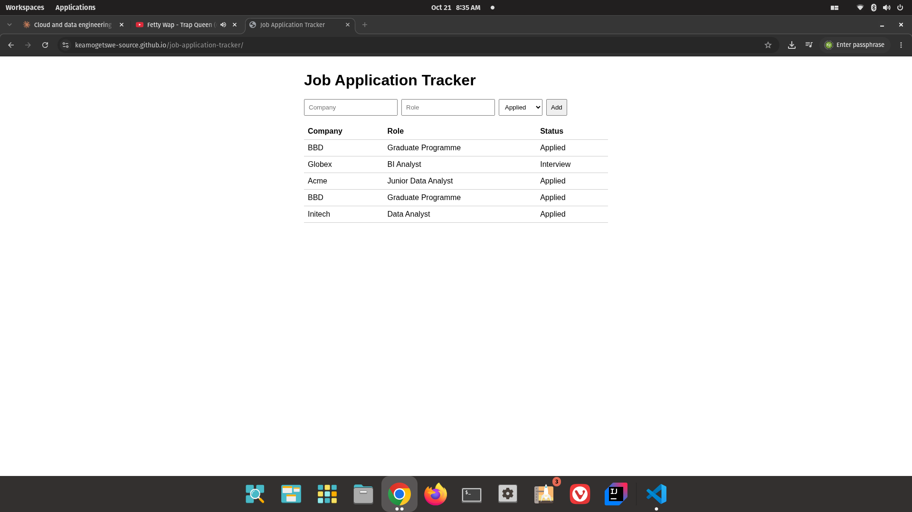
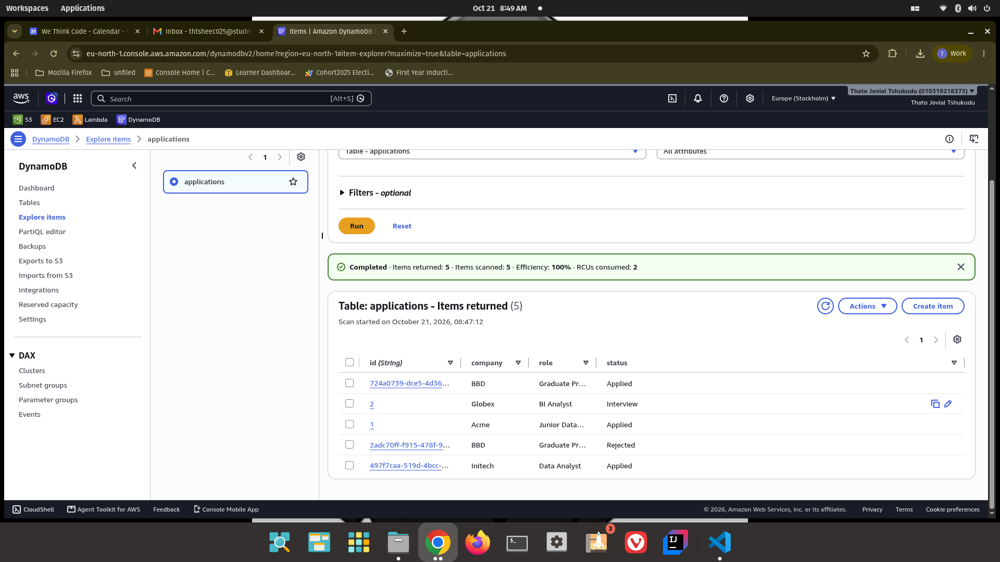
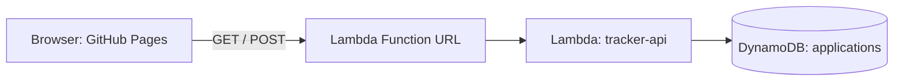

WTC-HUXMZ39P

# Job Application Tracker

A small serverless app on AWS for tracking job applications. Built over 5 days as a Cloud elective project.

**Live demo:** https://keamogetswe-source.github.io/job-application-tracker/

**Demo video:** coming soon

## Screenshots

## How it works

- **Frontend:** one HTML page on GitHub Pages
- **API:** a Python AWS Lambda function behind a Function URL
- **Database:** a DynamoDB table called `applications`
- **Region:** eu-north-1 (Stockholm)

## Files

- `index.html` is the page with the form and table
- `lambda_function.py` is the Lambda code (GET lists applications, POST adds one)

## Progress

- [x] Day 1: Lambda API
- [x] Day 2: Frontend page
- [x] Day 3: Read from DynamoDB
- [x] Day 4: Add create endpoint
- [x] Day 5: Docs

## Notes

This is a demo. The API link is public with no login, so anyone who has it can add rows. A real version would add authentication.